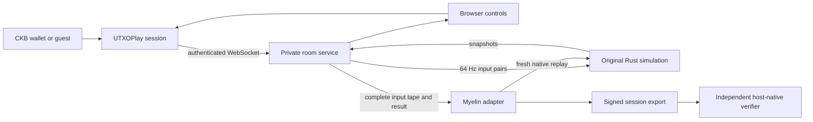

# OpenStrike on Myelin: Architecture and Porting Assessment

## Decision

The [Nervos discussion](https://talk.nervos.org/t/porting-couter-strike-to-fiber-network/10647) describes a small OpenStrike-based 1v1 demo, not a port of the commercial Counter-Strike distribution. Its independent Rust simulation makes a Myelin adaptation feasible. The implementation in this repository reuses that simulation and adds a browser frontend, authenticated room service, native replay bridge and Myelin session adapter.

The first UTXOPlay release is free practice and private duels. Fiber remains an optional native testnet experiment. We keep network input/rendering, result verification and payment logic separate.

## Components and boundaries

| Component | Responsibility | Authority |
|---|---|---|
| UTXOPlay | CKB wallet/guest login, catalog, account library, HTTP/WS proxy | Authenticated account and session revocation |
| Browser | First-person rendering, pointer/touch input, HUD, visual prediction | Presentation only; cannot choose health, hits or winners |
| Private Node room service | Room membership, 64 Hz scheduling, input validation, tape capture | Effective input ordering and player labels |
| Original native OpenStrike engine | Movement, obstacle collision, hitscan, weapon cooldown/reload, elimination | Authoritative gameplay |
| Native replay bridge | JSONL protocol, bounded execution, snapshots and full-trace hash | Reproduction of the supplied input tape |
| Myelin adapter | Application profile, PoA finality, storage, replay and export | Verifies native replay against the committed match |
| Optional upstream Fiber path | Held testnet invoices and release/cancel behavior | Separate trusted settlement-server experiment |

## Gameplay and network timing

One process runs one native match. The room service writes one input pair and waits for the resulting native frame before scheduling the next tick against a monotonic deadline. This avoids queued inputs crossing an elimination boundary. The renderer runs at display cadence, with immediate local aim, planar prediction, capped extrapolation and continuous correction. Rendering is never used to determine hits.

The map JSON is exported from `devmap` constants; collision push-out order in the visual predictor follows the same AABB order. The native engine remains authoritative when numerical differences occur. This first arena has a flat floor, covers and pylons; it has no bomb planting, teams, inventories or map rotation. These are future gameplay features, not implemented claims.

Inputs expire after 250 ms of silence. Lost focus or opening the menu sends neutral controls. A disconnect does not freeze or roll back the round. The UI reconnects to the account's current room. A process restart marks unfinished rooms interrupted; no verified result is issued for them. The 90-second limit ends a non-elimination round without fabricating a winner.

## Match commitment

1. The service records the exact JSONL controls submitted to the engine.
2. Every native tick contributes its state, native state hash and events to a BLAKE3 trace hash.
3. The bridge emits a completed result only after elimination or 5,760 ticks.
4. The Myelin executor independently re-runs the tape with the byte-pinned engine and requires equality with the submitted result.
5. Myelin finalizes a single complete-match frame with PoA, persists it in RocksDB and replays it again before offering an export.
6. An external verifier checks the application profile, authority signature, commitments and execution. The matching release includes both binaries and checksums.

JSON numbers are compared without tolerance after normalizing integer/float representation, because JavaScript rewrites `0.0` as `0`. Exact floating-point parsing is enabled. There is no rounding allowance that could conceal a changed position or result.

The profile commits to adapter source, dependency lockfile/configuration and the native executable bytes. The native bridge contains the arena and engine code. The replay claim is scoped to that exact binary/platform; it is not a promise of universal cross-platform floating-point determinism.

## What the result does not prove

A server can choose input ordering, omit an input before recording it, or associate an input stream with a player label. The native replay will prove that the **recorded** controls produce the recorded result; it does not prove input provenance, fair scheduling, that every wallet signed the tape, or absence of aim assistance. PoA authority identity is supplied in the export; applications must pin an expected authority separately if they need issuer identity, rather than accepting any self-consistent export as a trusted platform issuance.

The native host executor is not a CKB-VM-verifiable transition and is not an on-chain fraud proof. No Fiber payment is unlocked by this release, and wallet login does not spend CKB. A payment-bearing deployment requires additional player-signed checkpoints, input availability, dispute handling, agreed authority/policy and bounded liabilities.

## Runtime limits and deployment

The service requires a shared runtime token, binds requests to 64-hex account identifiers, validates controls, permits at most four waiting/running/sealing rooms, bounds socket payloads/rates and outbound buffering, and limits each match to 90 seconds. Replay workers run serially with a process timeout. Input tapes are bounded at 4 MB. Persisted room data and signing material are private to the runtime, with exports available only to that account's current completed room participants.

The store has no public direct runtime port. The runtime lives on the internal games network with read-only container root, dropped capabilities, a writable private data volume and bounded CPU/memory. Do not ship runtime tokens, session signing keys or production data in the Git repository or release archives.

## Fiber testnet extension

Upstream already implements a server-mediated hold-invoice workflow for damage buckets. Those modules and native client/server commands are retained. They are developer-only, testnet-oriented and separate from `/games/openstrike/`; simply configuring a Fiber node does not activate payments in the browser port.

A future Myelin/Fiber integration should settle an explicitly agreed economic checkpoint, not block each render or movement tick on payment RPC. Candidate next steps are: player-signed cumulative deltas, a maximum outstanding exposure per round, disclosed input availability windows, a concrete dispute path and an idempotent settlement worker. The host-native replay can support auditing but must not be presented as a trustless release condition without an enforceable verification/dispute design.

## Provenance

Base repository: `RetricSu/openstrike-fiber-arena`, commit `3b86ec14e552b6f238bcef77600c9c56fa135994`.
OpenStrike and Pocket3D remain pinned submodules. The procedural arena, browser-generated meshes and generated audio avoid redistributing Valve game assets. See `NOTICE.md` and the preserved upstream documentation.
